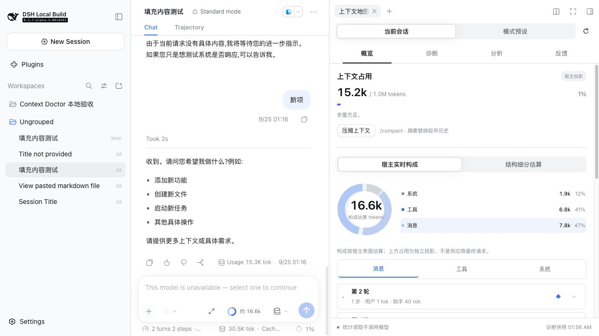

# @cheesefox/dsh-better-composer

[English](README.md) | 中文

[](https://github.com/CheeseFox259/dsh-better-composer/actions/workflows/ci.yml)
[](https://www.npmjs.com/package/@cheesefox/dsh-better-composer)
[](LICENSE)

## 摘要

DSH Better Composer 为 DSH Web Composer 增加保留 source 的 Markdown 视觉呈现与固定的本地补全候选。配置层通过 DSH 公开的 Composer seam 提供 Settings 与编辑器 presentation。source、selection、history、Context Objects 以及 Send/Queue/Steer 仍由 DSH Core 拥有。超长粘贴可自动转为可编辑的引用（chip），其大模型辅助编辑经 Host 侧独立的一次性调用完成，不写入会话事件流。


## 目录

- [使用本包](#使用本包)
- [了解实现](#了解实现)
- [进一步阅读](#进一步阅读)
- [模型体验](#模型体验)
- [已知限制与暂不处理事项](#已知限制与暂不处理事项)
- [开发说明](#开发说明)

-----

## Context Doctor（experimental）

本分支将 Context Doctor 集成到「上下文地图」：Composer 保留一个圆环入口，工作区分为当前会话 / 模式预设与「概览 / 诊断 / 分析 / 反馈」四页。概览完整保留原地图的轮次、步骤与全文浏览、系统和工具来源、缓存、结构、增长、锚定、压缩及分叉。默认使用宿主实时构成，另可切换 Doctor 持久化快照的结构细分估算；两种口径共用交互圆环，构成总量、窗口占用与供应商报告分别展示。界面以蓝、白、灰为主体，消息使用青绿色，结构分类补充协调且可区分的色相；字体、控件和深浅主题继承 DSH。

悬停或键盘聚焦仅预览分类；点击扇区、图例或分类标签固定浏览选择。「加入分析」是独立动作，由 Host 读取规范来源；聚合工具节点先展示来源集合供选择。诊断保留证据筛选及分页，分析先预览范围、模型与预算，明确开始才调用模型。跨页保留浏览与已选证据，切换对象使旧计划失效。历史内容可浏览和反馈，不在当前有效上下文中的来源不能加入本次分析。旧 Doctor 标签页通过 `0.1.7-alpha.2` 公开侧栏 API 转入诊断页。统计读取不调用模型、不启动冷 Agent；模式统计保留样本门槛和观测版本分组。

在「证据」页筛选、展开或勾选原文，然后进入「分析」页预览范围、模型与预算，再由用户启动一次分析。切换页面保留选择，切换分析对象重新建立范围。候选保留原文、条件、例外和来源，用户编辑并确认会话或模式范围后才生效。原文也可直接进入反馈，支持新建/关联问题和撤回；源会话确认删除后，相关原文摘录和分析结果会清除。

压缩增强通过模式配置预览和确认启用，保留原有阈值、模型路由及输出上限。独立入口为 `@cheesefox/dsh-better-composer/doctor-compaction`；它在同一次原有摘要调用的输入中融合要求，不做事后验证或重试。只影响新 Agent，无压缩模式不会自动添加压缩。卸载前先恢复基础提供方。

在插件根目录可启动隔离试用环境：

```sh
pnpm run bundle
node scripts/start-context-doctor-acceptance.mjs /path/to/deepseek-harness
```

脚本创建临时 DSH_HOME、随机空闲端口与静态样本，不复制凭据或发起模型请求；退出时清理本次临时环境。可选第三个参数为本地会话语料 JSON：每项含公开格式的 `header`、`rows` 和来源 `source`、`sha256`，通过公开 format catalog 恢复到临时工作区，并记录导入清单。真实原文语料只保存在本机临时文件，不放入仓库。真实模型分析及摘要调用需用户另行配置并主动启动。正式 npm `1.0.0` 不含此分支尚未发布的 Context Doctor。

<a id="使用本包"></a>
## 使用本包

### 前置条件

- 已安装原生 DSH，并且可使用 `web` profile。
- DSH `0.1.7-alpha.2` 或满足本包 peer dependencies 的更新版本。本次发布在 `@deepseek-ai/dsh@0.1.7-alpha.2` 上完成安装验证。
- Node.js `>=20`、pnpm `>=10`。
- DSH 能够打开一个工作区目录；文件送达模式需要已知的工作区路径。

先确认原生 DSH 可以启动：

```sh
dsh --version
dsh web --no-open
```

确认网页能够打开后，停止临时 Web 进程，再把插件加入你实际使用的 Web profile。

### 从 npm 安装正式版

```sh
pnpm dsh plugin --profile web add @cheesefox/dsh-better-composer@1.0.0
pnpm dsh web --no-open
```

打开 DSH 输出的 Web 地址，进入「设置 → 内置插件 → Better Composer」，确认插件已加载。新建会话，确认 Composer 视觉层与 `+` 菜单正常存在。

### 从 GitHub 源码安装

```sh
git clone https://github.com/CheeseFox259/dsh-better-composer.git
cd dsh-better-composer
pnpm install
pnpm run bundle
cd ..
pnpm dsh plugin --profile web add ./dsh-better-composer
pnpm dsh web --no-open
```

源码安装适合开发调试，使用当前 checkout 的代码。它不会修改 DSH Core；本包是 profile bundle patch 加 Host/Client 插件入口。

### 首次安装验收

1. 在 Web UI 中新建会话。
2. 粘贴超过阈值的文本，确认其变为「粘贴文本」chip。
3. 打开 chip，选择「文件送达」，在「文件类型」下拉框选择文本或代码扩展名；发送后确认文件写入 `.dsh/pastes/`。
4. 在粘贴文本编辑页修改内容，测试「撤销」和「重做」；应用智能改写预览后也测试这两个按钮。
5. 进入「设置 → 内置插件 → Better Composer」调整超长粘贴阈值。文件扩展名属于每个 clip，不在全局设置中选择。

### 卸载

```sh
pnpm dsh plugin --profile web remove @cheesefox/dsh-better-composer
```

修改 profile 组成后重启 Web DSH。卸载会移除插件的 overlay、Settings 卡片、clip source、右侧栏 tab 和 Remote contribution，不会修改已有会话历史或 Core 源码。

本包是 `dsh.bundle.patch` profile layer。该 patch 向当前 profile 插入一个 `dsh-better-composer` 行。客户端入口只在 Web 平台加载，并依赖 `package.json` 声明的 conversation、renderer、Settings 和 Settings-plugin 公开包。实验分支 Context Doctor 要求声明的 `0.1.7-alpha.2` 公开 seam，开发依赖固定该版本；具体实测宿主 revision 见运行验证记录。

### 提供的能力

- 为标题、强调、链接、任务列表、引用、表格、围栏代码和保留 source 的文件引用标签提供 Markdown 视觉增强。
- 为已批准的 fence language、task marker 和 heading spacing 提供确定性的本地补全，并为已批准的 prompt section heading 提供有界 ghost。
- 上下文地图（Composer 圆环打开右栏）：宿主投影占用 / 模型窗口、交互构成圆环、结构统计与逐轮增长。完整历史可按消息分类 → 轮 → 步骤 → 来源全文浏览；增长图各柱可查看轮次明细、锚定并定位消息；系统提示词与工具清单同样可查看全文。

  

- 上下文管理：地图内直接执行 /compact（带确认与压缩中状态，压缩点在轮次上标记）；任意已结束轮次可一键分叉；轮次可锚定并在增长图上显示蓝色刻线与菱形。
- 缓存可视化：命中率、当前上下文缓存覆盖与读/写 tokens（provider 前缀缓存自动生效）。
- 超长粘贴自动转为「粘贴文本」引用 chip（阈值可在 Settings 调整，0 关闭）：发送方式可选「直接进上下文」（提交时完整文本内联）或「以文件形式送达」（文本落盘为工作区文件，并以官方 `@path` 文件引用语法进入提交）；点击 chip 打开右侧栏编辑器后，选择「文件送达」即可选择文本或代码文件扩展名。编辑器支持手动修改，也可由大模型按指令改写；改写支持停止、预览、应用、撤销、重做和重试（独立的一次性调用，不写入当前会话事件流，可携带最近若干条会话消息与当前推理等级作为参考）。

  

- 四个 Settings 控件：启用 Better Composer、Markdown 视觉增强、非焦点行语法标记显示（完全隐藏或淡化）和超长粘贴转引用阈值。文件送达扩展名在每个粘贴文本编辑页中选择。旧的 `toolbarMode` 字段继续兼容读取，但不单独增加 UI 开关。

-----

<a id="了解实现"></a>
## 了解实现

<details>
<summary>实现细节 — 点击展开</summary>

[`src/index.ts`](src/index.ts) 中的 Host 入口安装 Settings schema、client bundle 和 `betterComposer` Remote 服务（`@Remote` 运行时标记，无需生成工件）。[`cordis.patch.yml`](cordis.patch.yml) 把 bundle 加入 profile。[`src/client/index.ts`](src/client/index.ts) 通过 effect-scoped 注册与清理管理 Settings、decorations、actions、editor surface、Settings card、clip source 与右侧栏 tab。

Markdown provider 读取权威 Composer snapshot 并输出 UTF-16 source range。editor surface 通过 Core 的通用 decoration 与 surface-extension seam 呈现这些 range。补全接受和语言变更都走现有 Core transaction path。ghost、table 和 code controls 都只是 presentation；它们不会创建第二份 source、selection、history、Context Object 或提交路径。

粘贴引用（`@clip:<id>`）的实现：editor surface 用单 revision 长度突增 + 前后缀 diff 检测超长粘贴，经公开的 `setDraft(text, references)` 把片段替换为 chip；`inputTriggers.registerSource` 注册的 codec 在提交时按送达模式展开为完整文本（inline）或官方风格的工作区文件引用（例如 `@.dsh/pastes/pasted-text-<id>.md`；Host 将文本写入 `<cwd>/.dsh/pastes/`）。chip 原文及扩展名持久化于 harness home（`storages/better-composer/pastes/`），刷新不丢。右侧栏编辑器经 `sidebarRightTabs` + `sidebar.right.pane.tab` 注册；「用大模型编辑」调用 Host 侧 `editText` Remote 方法，以独立 purpose 发起一次性、可取消的 LLM 请求，先返回预览，不 append 任何会话事件。

</details>

-----

<a id="进一步阅读"></a>
## 进一步阅读

- [`src/settings.ts`](src/settings.ts) — 持久化 Settings 字段与默认值。
- [`src/client/editor.tsx`](src/client/editor.tsx) — editor presentation 与交互 wiring。
- [`src/client/presentation-layout.ts`](src/client/presentation-layout.ts) — table 与 code presentation layout。
- [`src/markdown/provider.ts`](src/markdown/provider.ts) — source range 与 Markdown presentation 数据。
- [`tests/`](tests/) — parser、lifecycle、Settings、completion 和 presentation focused tests。

-----

<a id="模型体验"></a>
## 模型体验

「以文件形式送达」的粘贴引用在 prompt 里呈现为官方风格的工作区文件引用（`@.dsh/pastes/...`），由 Agent 的正常文件工具按需读取；「直接进上下文」则把完整文本内联进用户消息。「用大模型编辑」在会话外发起独立请求，模型看不到会话事件流，只看到插件显式携带的文本、指令、可选的近期消息摘录和当前推理等级，结果必须先经过用户预览再应用。

<a id="已知限制与暂不处理事项"></a>
## 已知限制与暂不处理事项

宿主必须提供声明的 Composer、Settings、input-trigger、右栏与 Remote 公开 seam；老宿主缺失某一项时对应能力单独关闭。支持的代码语言与文件扩展名列表是有限且本地的。纯插件无法创建 Core 内部的附件 receipt，因此文件送达使用官方工作区 `@path` 引用约定，而不是伪造原生二进制附件。file 送达模式要求会话工作区路径已知；旧 clip（cwd 捕获前创建）切到 file 模式会在发送时以明确错误阻止而不是静默失败。粘贴检测无法区分粘贴与其他单步大插入（IME 整段提交、undo），阈值可降低误判但不能归零。列表/引用的换行续行已在 Shift+Enter 上支持：按键时仅记录续行意图，待 Core 原生换行落入草稿后，再结算出一个不含换行的后续编辑（补 marker，或删除空项的 marker 以退出结构），因为公开 InputActions seam 无法在保留光标的前提下原子地分裂段落。普通 Enter 仍是 Core 的发送语义；在有序列表中间断行时，后续同级项会通过一串逐行数字改写自动重编号（每步各占一次撤销），因为原子改写会跨换行、超出 seam 表达能力。底层 seam 分析参见 [Issue #1 (RFC)](https://github.com/CheeseFox259/dsh-better-composer/issues/1)。浏览器验收属于宿主 release 流程；本仓库的自动化检查不能替代维护者的真实浏览器复核。

<a id="开发说明"></a>
### 开发说明

<details>
<summary>维护者工作说明 — 点击展开</summary>

本包使用现有 DSH profile bundle 机制和本地 package scripts。在此目录运行 `pnpm test`、`pnpm run typecheck`、`pnpm run bundle` 和 `pnpm run pack:check`。

</details>
